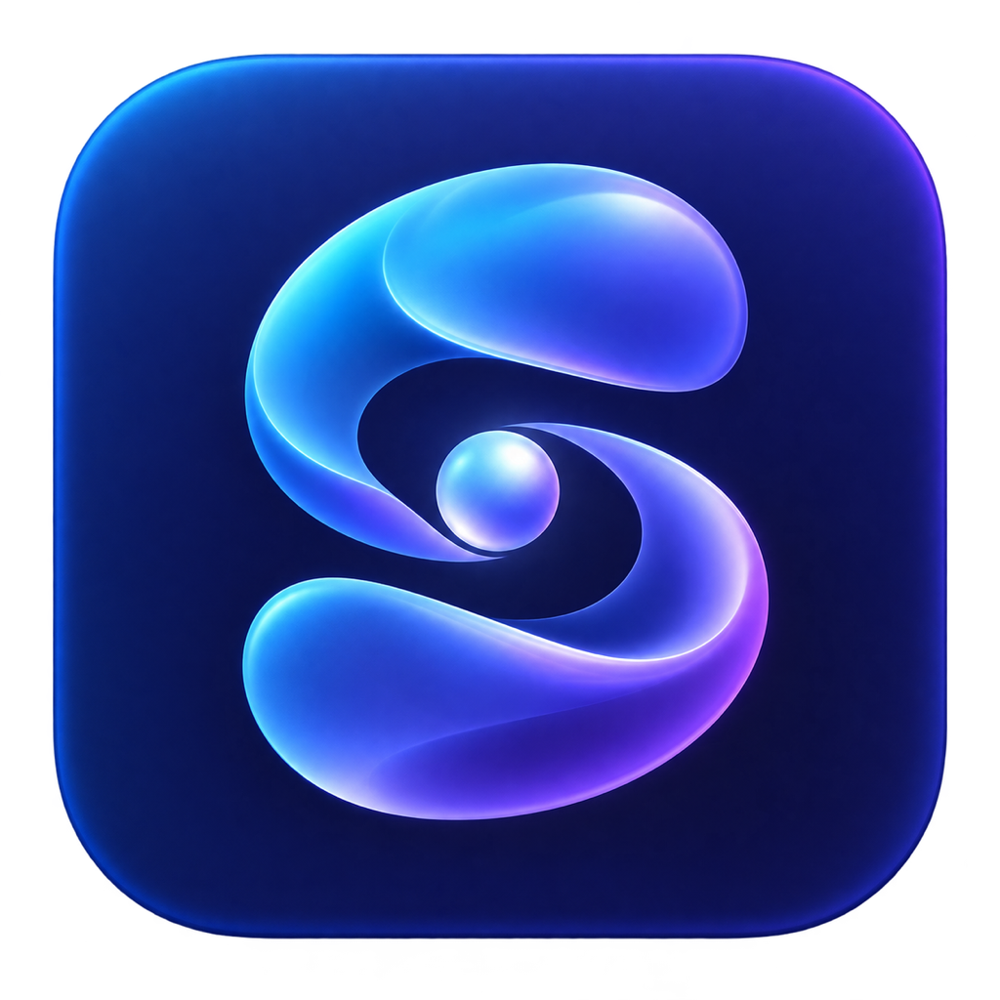

<p align="center">
  
</p>

# Synomancer · 思诺曼

以 SwiftUI 和 Swift + MLX 构建的 Apple Silicon 本地 AI 客户端。
聊天、图片生成与编辑、语音识别和朗读在设备上运行；也可选用 Google Gemini 文本模型。

## 功能

- 本地多轮聊天、流式回答、思考区、图片理解及 macOS 快捷补全。
- Muse Glimmer MXFP8、受支持的 Qwen/Gemma 模型，以及原生 Qwen GGUF 推理。
  模型兼容性以[聊天文档](docs/LocalChat.md)和[模型库说明](docs/MLXModelLibrary.md)为准。
- FLUX / Qwen 图像生成与编辑，Qwen3-ASR 和 Qwen3-TTS 本地语音管线。
- 原生 Hugging Face 模型下载，支持续传、分片校验及共享 HF 缓存。
- 可选 Gemini 文本聊天，以及仅绑定 loopback、需要访问令牌的本地模型 API。

不同模型需要不同的内存容量、权重格式和访问权限；下载完成不代表该架构已受支持。
仓库不包含模型权重、个人配置、访问凭证、录音或验收日志。

## MoE 模型的分层优化

对已适配的 MoE 模型，按模型架构和权重格式选择原生执行路径。其中，
Qwen3.8-Flash-Next IQ3_S 的 GGUF 后端提供以下分层优化：

| 层级 | 支持的优化 |
| --- | --- |
| 权重与内存 | 映射 GGUF 分片，按需读取命中的路由专家并使用有预算上限的 LRU 缓存；PLE 嵌入按行读取。 |
| 逐层计算 | 逐层选择专家并控制临时缓冲的生命周期；预填充使用分组量化 GEMM，解码使用量化 GEMV，保留专家权重的压缩格式。 |
| 算子与解码 | 使用 SIMD top-10 路由、GDN 卷积/SiLU、专家结果合并等 Metal 融合算子；兼容权重在温度 0 时可启用经主模型验证的 MTP 推测解码。 |
| 任务调度 | 聊天与图像任务共享执行门控；开始图像任务前释放已加载的聊天权重，控制模型同时驻留带来的内存占用。 |

可在设置 → Chat Models → **Flash-Next 专家缓存** 中调整缓存预算，
权衡内存驻留与按需读取的开销。不同模型路径采用的优化不同；
支持的导出格式、MTP 条件、内存限制和实测结果见[本地聊天文档](docs/LocalChat.md)。

## 与 llama.cpp / Python MLX 的性能对照

以下为 2026 年 10 月的同机历史记录：Apple M4 Max、128 GB 统一内存，
同一 Qwen3.8-Flash-Next IQ3_S 混合量化权重，47 token 输入、256 token 输出、
温度 0。每项预热一次后取三次均值；模型保持加载，关闭请求间提示缓存复用。
预填充不含冷加载，解码吞吐不含预填充提供的首 token，输出均通过 256 token 对照。

| 后端 | 普通预填充（秒） | 普通解码（token/s） | MTP 预填充（秒） | MTP 解码（token/s） |
| --- | ---: | ---: | ---: | ---: |
| Synomancer Native Swift + MLX（全驻留优化路径） | 0.423 | 46.42 | 0.438 | 83.31 |
| Python MLX 参考实现 | 0.482 | 43.68 | 0.493 | 73.74 |
| llama.cpp（本地修补版） | 0.287 | 38.56 | 0.282 | 78.57 |

llama.cpp 使用 `8a1a9b5` 加 MTP 内存分配修补，Metal 全层卸载、12 线程、
batch/ubatch 512、Flash Attention；MTP 使用完整的修复版 sidecar，最多三个草稿 token。
Python 行是本项目的 GGUF/MLX 参考实现。各后端顺序测量，系统负载和运行时序会影响结果；
表中记录对应全驻留优化阶段，当前默认的专家分页模式另有内存/速度权衡。
各版本、其他模型和长上下文需分别测量，不能据此推断普遍加速比例。
Native 与 Python 的更多测试条件及分页数据见[性能记录](docs/LocalChat.md#bounded-gguf-weight-residency)。

## 构建

当前 macOS target 要求 Apple Silicon、macOS 27 和具有相应 SDK 的 Xcode。
使用 Swift 6；在 Xcode 中打开 `Synomancer.xcodeproj`，选择 **Synomancer-Release**。
签名和开发团队在自己的 Xcode 设置中配置。

无需签名的本机 Release 构建：

```sh
git clone git@github.com:charwliu/Synomancer.git
cd Synomancer
xcodebuild -project Synomancer.xcodeproj -scheme Synomancer-Release \
  -configuration Release -destination 'platform=macOS' \
  -derivedDataPath .build/DerivedData \
  -clonedSourcePackagesDirPath .build/SourcePackages \
  CODE_SIGNING_ALLOWED=NO build
```

首次构建需要解析和下载 Swift Package 依赖。构建产物位于
`.build/DerivedData/Build/Products/Release/Synomancer.app`。
`Libraries/` 中包含本地包及历史适配；当前聊天模型库来自 Xcode 固定的 SPM 依赖，
不要把历史 MLX 目录当作当前运行时入口。

## 初次使用

1. 在设置 → Hugging Face 中选择 **HF_HOME** 并授权访问。
   未配置时使用当前用户主目录下的 `.cache/huggingface/hub`；可自行选择其他磁盘。
2. 下载兼容模型，或选择已有的完整 HF 缓存，刷新模型列表后选择模型。
3. Gemini API Key 在设置中输入并保存在 Keychain；HF Token 仅供本次下载使用。
   不要将凭证写进代码、配置示例、日志或提交信息。

本地模型推理不需要外部推理服务。Hugging Face 下载会访问网络；启用 Gemini 后，
远程请求会把会话文本发送到 Google。

## 文档与测试

| 内容 | 文档 |
| --- | --- |
| 本地聊天与 Muse Native | [LocalChat.md](docs/LocalChat.md) |
| MLX 模型库和量化适配 | [MLXModelLibrary.md](docs/MLXModelLibrary.md) |
| 图像生成与编辑 | [LocalImages.md](docs/LocalImages.md) |
| HF 下载与缓存 | [HuggingFaceDownloads.md](docs/HuggingFaceDownloads.md) |
| Gemini 与本地 API | [ChatAPI.md](docs/ChatAPI.md) |
| 语音识别 | [LocalSpeechRecognition.md](docs/LocalSpeechRecognition.md) |
| 朗读 | [LocalTextToSpeech.md](docs/LocalTextToSpeech.md) |

先构建 Release，再按各文档运行 `Tests/` 下的独立测试。多个聊天/图像测试共用
`SynomancerASRSmoke`，须顺序运行。合成检查不能代替真实模型推理；后者需要
兼容硬件和完整权重。输出、临时数据库及测试日志统一保存在忽略 Git 的 `.build/`。

贡献约定见 [AGENTS.md](AGENTS.md)。各本地包及第三方适配保留各自的许可与来源说明。
